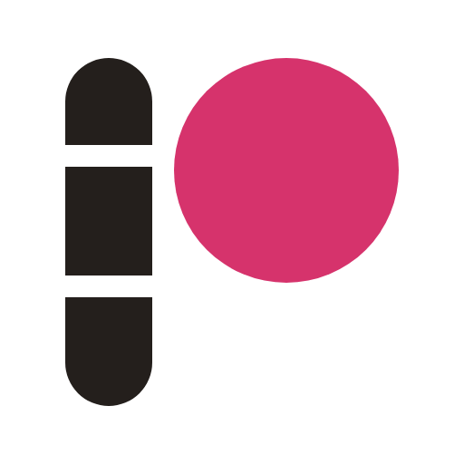
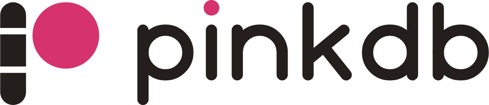

# pinkdb brand

The logo, colors and type for pinkdb. Every logo file is generated by
[`make-brand.py`](make-brand.py) from one set of shapes, so change the
geometry there and regenerate; don't hand-edit the SVGs. It also writes the
docs site's favicon, touch icon and social card
(`website/src/assets/`). The console inlines the favicon as a data URI
(`FAVICON` in `crates/pinkdb-server-ui/src/html.rs`): update it by hand if
the favicon changes.

```sh
python3 brand/make-brand.py          # rewrite the SVGs
python3 brand/make-brand.py --png    # also render brand/png/ (needs Google Chrome)
```

Open [`index.html`](index.html) for a one-page brand sheet.

## 1. Name

* Write **pinkdb**: lowercase, one word, in prose, code, and the logo,
  including at the start of a sentence. Say it "pink D B".
* Not *PinkDB*, *Pink DB*, *PINKDB* or *pinkDB*.
* Product surfaces append a plain word, not a new name: *pinkdb Warehouse*,
  *pinkdb console*, *pinkdb lake*.

## 2. The mark



A lowercase **p** made of two parts:

* **The stem is a column.** A capsule cut into three row groups shows the
  storage model: columnar data stored in chunks.
* **The bowl is the pink dot.** It is the value a query returns, and the
  one place the brand color appears. The same dot is the tittle of the
  wordmark's *i*.

### Construction (64-unit grid)

| Part | Geometry |
| --- | --- |
| Content box | x 9–55, y 8–56 (46 × 48), centered on the grid |
| Stem | 12 wide, x 9–21, y 8–56, end radius 6 (fully round) |
| Cuts | 3 high, at y 20–23 and y 38–41; segments 12 / 15 / 15 (plus caps) |
| Dot | center (39.5, 23.5), r 15.5: top aligns with the stem top, bottom with cut 2 |
| Stem–dot gap | 3, the same as the cuts |

Below 24 px the cuts blur, so the favicon uses a **solid stem**
(`MARK_STEM_SOLID`) with otherwise the same geometry.

## 3. The wordmark



Custom-drawn, not set in a font, so it needs no font license and renders
the same everywhere. Monoline geometric lowercase, built from the
same parts as the mark: round-capped stems and full-circle bowls.

| Metric | Units |
| --- | --- |
| Stroke | 10, round caps and joins |
| x-height | 50 (y 40–90, baseline 90) |
| Ascender / descender | y 20 / y 112 |
| Bowls (p, d, b) | circles r 20 on the stroke centerline |
| *i* dot | r 7, pink |

*d* and *b* sit back to back, so **db** is symmetric.

## 4. Logo files

All in `logo/` and `icon/`. Each logo comes in three versions:

| Suffix | Ink | Dot | Use on |
| --- | --- | --- | --- |
| *(none)* | Ink | Pink | Paper, white and light backgrounds |
| `-reverse` | Paper | Pink | Ink and dark backgrounds |
| `-mono` | `currentColor` | `currentColor` | Single-color print, embossing, inline SVG that follows text color |

| File | What |
| --- | --- |
| `pinkdb-lockup*.svg` | **Primary logo**: mark beside the wordmark |
| `pinkdb-lockup-stacked*.svg` | Square-ish spaces: covers, stickers, splash screens |
| `pinkdb-mark*.svg` | Mark alone: avatars, small spaces, when "pinkdb" is already nearby |
| `pinkdb-wordmark*.svg` | Wordmark alone: running text headers, footers |
| `icon/app-icon.svg` | **Primary app icon**: ink tile, paper stem, pink dot |
| `icon/app-icon-light.svg` | Paper tile, for light contexts |
| `icon/app-icon-pink.svg` | Pink tile, ink dot. Promotional use only (stickers, swag), never in product UI |
| `icon/favicon.svg` | 32-unit favicon with the solid stem |

`-mono` files use `currentColor`, which applies only when the SVG is
**inlined**. Loaded through ``, they render black.

PNGs in `png/`: favicons (16/32/48/64), `apple-touch-icon.png` (180),
app icons (192/512/1024), the mark (512) and lockups (1200 / 800 wide).

### Clear space and minimum size

* **Clear space**: keep a margin of at least the dot's radius (½ of the
  mark's dot diameter) on every side of the mark or lockup.
* **Minimum size**: lockup 96 px wide (screen) / 20 mm (print). Mark 16 px.
  Below 24 px, use `favicon.svg`.

### Don't

* Recolor the stem pink, or the dot anything but pink (mono versions excepted).
* Use more than one pink dot in a composition. The dot is the only accent.
* Retype the wordmark in a font, stretch it, add outlines, shadows or
  gradients.
* Close or move the cuts in the stem at sizes above 24 px.
* Put the default (ink) logo on dark or busy backgrounds. Use `-reverse`,
  or place the logo on a paper or ink tile.

## 5. Color

| Name | Hex | RGB | Role |
| --- | --- | --- | --- |
| **Pink** | `#D6336C` | 214 51 108 | The dot. Primary actions. Never body text on ink |
| **Ink** | `#241F1C` | 36 31 28 | Logo, text, dark tiles |
| **Paper** | `#F7F1E8` | 247 241 232 | Backgrounds, reversed logo |

Pink is the console's `accent-700`. Contrast: Pink on white 4.6:1, on Paper
4.1:1, on Ink 3.5:1. All pass the 3:1 rule for graphics and large text. For
small pink *text*, use the console's `accent-800` `#C2255C` on light
backgrounds and `accent-400` `#F783AC` (6.8:1) on Ink. Ink on Paper is 14.5:1.

Supporting ramps (tints, grays, status colors) are defined by the console
design system in
[`docs/console-design/README.md`](../docs/console-design/README.md#31-color--palette).

The docs site (`--pink`), the extension repository's info page and the
console (`--accent`) all use this pink; the console's logo badge is drawn in
CSS (`.brand__mark` in `console.css`) with the small-size solid stem.

## 6. Type

| Role | Typeface | Where |
| --- | --- | --- |
| Display | Bricolage Grotesque 600–800 | Headlines, the site, slides |
| Text | Public Sans | Body copy |
| Code and data | JetBrains Mono | SQL, results, terminals |

All three are OFL and already vendored in `website/src/assets/fonts/`. The
console uses system fonts by design (no font files, see its design
system). Logo text is always the drawn wordmark, never a font.

## 7. Voice

pinkdb is a small, fast, embedded analytical database. Write like the README:
plain, specific and brief. Show a query and its result instead of
adjectives. Back claims with a benchmark number and how it was measured,
not superlatives. Pink is a color, not a personality: no puns or "think pink".
